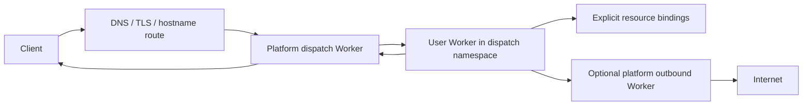

# Workers for Platforms: Nanoflare design and API alignment

Research date: 2026-10-15. Repository baseline: `c7547cbb4a0d26740dc8f3e5688f86a996a78c20`.

Next work is tracked in the [overall implementation plan](../plans/workers-for-platforms-implementation.md), ordered from authorization fixes through native dispatch, production qualification and compatibility.

Status: research and proposed design; the APIs below are not implemented. Cloudflare facts, repository observations, recommendations, and unresolved feasibility questions are distinguished throughout. This is a source review, not a deployed security assessment or a claim of production equivalence.

**PoC update, 2026-10-18:** the [local feasibility experiment](../../scripts/wfp-poc/README.md) now demonstrates namespace lookup, native request props/RPC, independent customer source updates, and restricted capability attachment using the experimental Worker Loader on workerd 2025-12-10 and 2026-10-18. Native props/RPC are therefore feasible; the HTTP-only fallback below is no longer the preferred first prototype. Both tested versions still failed the bounded CPU/subrequest enforcement probes. Existing Nanoflare telemetry identity forgery, cross-handler access through the telemetry capability (including an unbound KV read in the in-memory fixture), and corporate-proxy allowlist bypass were reproduced. The detailed findings below retain the original source-review context; the PoC report records what was actually exercised and which production gates remain open.

**Step 2 update, 2026-10-18:** runtime authorization is now implemented locally: signed per-deployment/resource grants, authenticated resource and telemetry handlers, native tail log attribution, exact asset/grant snapshots, and live local/remote runner checks. Memory and real PostgreSQL regression tests pass; both workerd versions reject the original identity-forgery and telemetry-to-KV probes. See the [implementation status](../plans/workers-for-platforms-step-2-status.md). The repository observations below describe the pre-fix baseline except where noted. CPU/subrequest, sandbox and corporate-egress blockers remain open; WFP APIs remain proposed.

**Step 3 update, 2026-10-18:** the [Linux execution/isolation experiment](../plans/workers-for-platforms-step-3-status.md) demonstrates bounded fault containment in separate customer containers and a shared external counter over synthetic effect paths. CPU interruption remains absent; [real CPU enforcement](../plans/workers-for-platforms-cpu-enforcement.md) is a separate requested workstream. Production sandbox, cross-process capability transport and budget integration remain release gates.

**Step 3 completion:** the [execution decision](../architecture/workers-for-platforms-execution.md) selects the trusted-only implementation boundary and a restricted typed bridge for future customer cells. The final PoC verifies warm revision reuse with fresh per-request native props, response-stream revision pinning, cancellation/revocation, bounded background authority and admission. General cross-process native RPC and warm request-specific global fetch are explicitly deferred; untrusted release gates remain open.

**Step 4 update:** the native namespace/script/grant model and APIs are implemented locally, including private exposure, customer-scoped resource authorization, policy history and PostgreSQL migration preservation. See the [step 4 status](../plans/workers-for-platforms-step-4-status.md). The proposed dynamic-dispatch and Cloudflare compatibility APIs below remain unimplemented.

## Recommendation

Align Nanoflare around **explicit capabilities, namespace-scoped dynamic dispatch, and platform-controlled policy**. Preserve its organization API and revision/traffic model. Add WFP-compatible runtime vocabulary where the implementation can support its behavior, and publish the remaining differences.

Nanoflare currently targets trusted business applications. Its shared `workerd` pool and familiar binding APIs are a useful foundation, but they do not establish the operational or security guarantees required for arbitrary customer code. Cloudflare explicitly says standalone `workerd` needs an additional secure sandbox when executing potentially malicious code. A namespace setting alone cannot supply that boundary. [workerd security guidance][S16]

The highest-priority work is:

1. Define platform ownership, customer tenancy, namespaces, and resource grants separately.
2. Introduce private user Workers and a dispatch capability without public-route bypasses.
3. Make egress, telemetry identity, and resource authorization enforceable outside customer JavaScript.
4. Prove CPU interruption and sandbox boundaries before enabling an untrusted execution profile.
5. Add a compatibility adapter for Cloudflare deployment metadata rather than replace Nanoflare's native deployment API.

## 1. The Cloudflare contract

### 1.1 Components and ownership

WFP has four principal components: a dispatch namespace containing user Workers, a platform-owned dispatch Worker, customer-supplied user Workers, and an optional outbound Worker. Cloudflare recommends one namespace across customers for an environment, with another for staging; it explicitly advises against a namespace per customer. Static service bindings remain useful for known internal dependencies. [Architecture][S02]



**Design inference:** a dispatch namespace is an execution/routing grouping, not the customer identity or an automatic database partition. The platform still needs a customer-to-script and customer-to-resource authorization model.

### 1.2 Isolation modes

| Behavior              | Untrusted namespace, the default                   | Trusted namespace                                      |
| --------------------- | -------------------------------------------------- | ------------------------------------------------------ |
| Intended code owner   | Customers can control deployed code                | Platform controls all code                             |
| Incoming `request.cf` | Unavailable                                        | Available                                              |
| Cache space           | Worker-isolated Cache API and fetch-cache behavior | Shared Cache API space                                 |
| `caches.default`      | Disabled                                           | Do not infer a guarantee from the isolation page alone |

Cloudflare exposes `trusted_workers: true` through namespace update. Existing Workers need redeployment before gaining `request.cf`; newly deployed Workers get it immediately. The isolation guide describes shared caches within a namespace, while the API describes zone-shared caches. Treat trusted caching as shared and verify its exact scope before depending on it. [Isolation][S01], [namespace API][S18]

**Recommendation:** use untrusted as the target default for newly created customer namespaces, but expose it only when the runner can actually enforce the advertised profile. Preserve existing installations through an explicitly named legacy trusted profile. Never manufacture Cloudflare-specific `cf` features merely to fill out a familiar object.

### 1.3 Dispatch, invocation context, and capabilities

The central call is `env.DISPATCHER.get(scriptName, options?, dispatchOptions?)`, followed by `.fetch(request)`. The second argument can supply `props`, received as `ctx.props` or `this.ctx.props`. Props may include request-scoped RPC capabilities; those stubs cannot be reused in later requests. The third argument carries outbound parameter values, separately from user-visible props. Outbound parameters support JSON. [Dynamic dispatch][S03]

Cloudflare configures the dispatcher's authority using `dispatch_namespaces`, including a binding name, namespace, and optionally an outbound service with declared parameter names. A binding authorizes access to the namespace, so platform routing code must choose the correct customer script. [Dynamic dispatch][S03]

**Recommendation:** a dispatch binding should be a privileged platform capability. Customer Workers should receive only specifically granted services or request-scoped platform capabilities. Customer-supplied script names, headers, and props cannot establish tenancy.

### 1.4 Execution limits

WFP accepts invocation limits in the third argument:

```js
const worker = env.DISPATCHER.get(
  "customer-script",
  {},
  {
    limits: { cpuMs: 10, subRequests: 5 },
  },
);
return worker.fetch(request);
```

The documented controls are CPU milliseconds and subrequest count per invocation; hitting either throws an exception. [Custom limits][S04]

**Recommendation:** distinguish CPU, wall time, subrequests, concurrency, memory, and storage quotas. A proxy timeout does not interrupt a JavaScript infinite loop. A process CPU quota constrains the pool and does not establish per-invocation CPU accounting. Keep precise CPU support unavailable until the execution layer proves it.

### 1.5 Outbound policy

An outbound Worker intercepts outgoing user-Worker `fetch()` calls and can inspect destinations, log traffic, and inject platform credentials. With outbound Workers enabled, user Workers cannot use `connect()` to bypass the fetch path. Cloudflare documents exceptions: outbound Workers do not intercept requests made by Durable Objects or mTLS certificate bindings. [Outbound Workers][S05]

**Recommendation:** specify interception coverage for every supported transport and capability. Treat public fetch, raw sockets, service bindings, DNS, storage adapters, and background handlers as distinct paths. In a customer-code profile, private networks should require an explicit capability grant.

### 1.6 Bindings and storage

Upload-time bindings persist across invocations. WFP supports resources including KV, D1, R2, Durable Objects, queues, workflows, and private networking. Each Worker receives only attached bindings; a separate resource per Worker can provide resource isolation. Upload configuration goes into multipart metadata, not an uploaded Wrangler configuration file. `keep_bindings` preserves specified binding kinds across updates. [Bindings][S06]

**Recommendation:** copying method names is only one compatibility layer. Publish behavior and limitations separately for KV consistency/TTL, database transactions/bookmarks, object storage metadata/conditions/multipart, and resource sharing. A shared resource remains shared even when attached to otherwise isolated Workers.

### 1.7 Routing and domains

Cloudflare recommends a wildcard route into the dispatcher, which maps managed subdomains or vanity domains to Workers. Custom-hostname provisioning is handled with Cloudflare for SaaS. Routing can depend on hostname, path, or platform metadata. [Hostname routing][S07]

**Recommendation:** separate script identity from hostnames. A private user Worker should need no hostname. Model domain ownership validation and certificate status explicitly; a successful hostname update must not imply successful DNS or TLS provisioning.

### 1.8 Static assets

The WFP upload flow is: submit a path/hash/size manifest, receive missing hash groups and a short-lived upload token, upload the missing bytes, then deploy with the completion token. Empty missing groups can skip uploading. Asset metadata supports HTML and not-found handling. [Static assets][S08], [multipart metadata][S15]

**Recommendation:** retain Nanoflare's MinIO-backed asset implementation and add manifest/deduplication/upload-session semantics if needed. Keep deployment identity attached to every asset lookup so simultaneous revisions cannot mix files. Authorize the request before serving assets when a dispatcher or protected route requires authentication.

### 1.9 Observability

Current WFP documentation covers managed Workers Logs, Logpush, Tail Workers, Analytics Engine, and GraphQL metrics. Upload metadata controls log collection and sampling. Tenant-facing queries must be scoped server-side to the user's Worker; browser-supplied script filters are insufficient. Metrics can be queried independently of log collection. [Observability][S09]

**Recommendation:** keep Nanoflare's current telemetry backends, but make worker identity originate in trusted infrastructure. Separate ingress requests, individual Worker invocations, CPU time, elapsed handler time, response duration, and background execution.

### 1.10 Tags, lifecycle constraints, local development, and cost

Tags support organization and bulk operations; Cloudflare allows eight per script. They are metadata, not access-control identities. [Tags][S10]

WFP currently documents no script-count ceiling and no Durable Object namespace ceiling. Its limits page says user Workers do not support gradual deployments: an upload creates a version deployed at 100%. The documented general client API quota is 1,200 calls per five minutes, with a separate 200 calls/second IP limit. [Limits][S11]

Local WFP testing can run a dispatcher locally with a remote dispatch binding (`remote: true`) to deployed user Workers. Staging is recommended for safe testing. [Local development][S12]

The published paid plan is $25/month, including 20 million requests, 60 million CPU ms, and 1,000 scripts; overages are $0.30/million requests, $0.02/million CPU ms, and $0.02/script. One request is charged across dispatcher → user → outbound, while CPU is aggregated across the chain. The WFP pricing page lists a 30-second CPU maximum per invocation and a 15-minute maximum for cron/queue invocations. These are dated commercial references, not proposed Nanoflare defaults. [Pricing][S13]

**Recommendation:** preserve Nanoflare weighted traffic as an extension. Do not interpret “unlimited scripts” as unlimited physical capacity. Implement deployment throttling and retry/backoff for any Cloudflare backend adapter. Keep a top-level request identifier to avoid counting every internal hop as a separate external request.

## 2. Cloudflare management API surface

The following paths are relative to `https://api.cloudflare.com/client/v4`. `N` below means `/accounts/{account_id}/workers/dispatch/namespaces/{namespace}`; `W` means `N/scripts/{script_name}`.

| Operation                        | Cloudflare HTTP surface                                                                      |
| -------------------------------- | -------------------------------------------------------------------------------------------- |
| List/create namespaces           | `GET` / `POST /accounts/{account_id}/workers/dispatch/namespaces`                            |
| Retrieve/update/delete namespace | Namespace resource under `N`; update uses `PUT` in the isolation example                     |
| List scripts / bulk delete       | `GET` / `DELETE N/scripts?tags=customer-123%3Ayes`; `tag:yes` includes and `tag:no` excludes |
| Upload/replace script            | `PUT W`, multipart body                                                                      |
| Get/delete script                | `GET` / `DELETE W`                                                                           |
| Read/replace content             | `GET` / `PUT W/content`                                                                      |
| Read/patch settings              | `GET` / `PATCH W/settings`                                                                   |
| Read bindings                    | `GET W/bindings`                                                                             |
| List/write/delete secrets        | `GET` / `PUT W/secrets`; `DELETE W/secrets/{name}`                                           |
| Bulk secret patch                | `PATCH W/secrets-bulk`                                                                       |
| Read/replace tags                | `GET` / `PUT W/tags`                                                                         |
| Remove a tag                     | `DELETE W/tags/{tag}`                                                                        |
| Start asset upload               | `POST W/assets-upload-session`                                                               |

Sources: [API overview][S14], [namespace list][S17], [namespace create][S18], [script upload][S19], [tag filtering and bulk deletion][S10]. Authentication uses a bearer API token with appropriate Workers permissions. Responses use Cloudflare's success/result/errors/messages envelope. These paths describe Cloudflare; they are not existing Nanoflare endpoints.

Module uploads specify `metadata.main_module`, compatibility settings, and typed `bindings`. Other metadata includes asset configuration, preservation controls, placement, logging, and tags. Verify each field against the WFP endpoint rather than assuming all ordinary Workers features apply. [Multipart metadata][S15]

Important documentation boundaries:

- The API/SDK overview does not enumerate every operation shown in product guides (notably namespace trust updates and tag-filtered script operations). Treat those guide examples as requiring live contract verification before SDK integration.
- The namespace creation reference currently lists `name` in the request body and returns `trusted_workers`; the isolation guide demonstrates setting trust with a later namespace `PUT`. Do not assume create accepts every returned property.
- General upload schemas contain fields and descriptions shared with ordinary Workers, including gradual-deployment language. The product-specific WFP limits page explicitly says gradual deployment is unsupported. Prefer that product constraint until live behavior is verified.
- The outbound guide's example declares one parameter object but later reads top-level environment fields. Use the consistent `requestContext` object pattern in the dynamic-dispatch guide; verify the actual parameter envelope in a contract test.
- The docs do not fully define custom-limit inheritance through nested services, every subrequest category, or the exact error type for every failure. Those require live probes before claiming exact parity.

## 3. What Nanoflare actually implements

These observations come from the source at the baseline above. No test suite, live Cloudflare account, or deployed Nanoflare environment was exercised for this source review.

| Area                     | Repository evidence                                                                                                                                                          | Alignment assessment                                                                                                                    |
| ------------------------ | ---------------------------------------------------------------------------------------------------------------------------------------------------------------------------- | --------------------------------------------------------------------------------------------------------------------------------------- |
| Product scope            | [README](../../README.md#L3) describes trusted business apps                                                                                                                 | An explicit scope change is needed to accept hostile customer code                                                                      |
| Ownership and identity   | [App / Deployment / DeployInput](../../internal/nanoflare/model.go#L11)                                                                                                      | Organization ownership exists; no dispatch namespace, customer tenant field, or Worker role                                             |
| Control API              | [Worker routes](../../internal/api/server_apps.go#L25)                                                                                                                       | Organization-scoped JSON API; no WFP namespace/script surface                                                                           |
| Resource authorization   | [DeployForOrg](../../internal/nanoflare/service.go#L1313) checks resource organization; runtime adapters use capabilities                                                    | Strong foundation; organization ownership does not distinguish customers inside one platform organization                               |
| Static services          | [ServiceBinding](../../internal/nanoflare/model.go#L362), [normalization](../../internal/nanoflare/service.go#L1537)                                                         | Same-organization target by name; no dynamic namespace binding or named-entrypoint configuration                                        |
| Service target selection | [activeServiceByName](../../internal/config/writer.go#L318) picks the first matching active entry                                                                            | Does not use the HTTP gateway's weighted selection policy                                                                               |
| Runtime loading          | [Manager.prepare](../../internal/runtime/manager.go#L163) starts a generation containing active deployments                                                                  | A deployment replaces the shared pool generation; dispatch naming alone will not make loading independent                               |
| HTTP/asset routing       | [appGateway](../../internal/api/server_apps.go#L319) resolves revisions and serves assets; [Traefik generator](../../internal/config/writer.go#L908) emits host routes       | Existing routing can be reused; there is no programmable platform dispatcher                                                            |
| Egress                   | [DefaultNetworkAllow](../../internal/config/writer.go#L67), [WorkerdWithOptions](../../internal/config/writer.go#L166), [egress adapter](../../internal/egress/egress.go#L1) | Defaults include public addresses and `10.0.0.0/8`; optional corporate proxy is shared rather than a request-scoped WFP outbound Worker |
| Cache isolation          | Generated Worker config has no `cacheApiOutbound` policy                                                                                                                     | No reviewed implementation of WFP cache isolation; this does not establish that cross-Worker cache access currently works               |
| Limits                   | [OrgLimits](../../internal/nanoflare/limits.go#L17)                                                                                                                          | Resource counts/storage budgets exist; no invocation CPU/subrequest policy in deployment or runner model                                |
| CPU metric               | [duration instrumentation](../../internal/config/writer.go#L637), [metric exporter](../../internal/api/server_metrics.go#L150)                                               | “CPU p90” is sourced from `Date.now()` elapsed handler duration; it is not measured CPU                                                 |
| Telemetry trust          | [RuntimeDurationServer](../../internal/api/runtime_duration.go#L24), [worker bindings](../../internal/config/writer.go#L265)                                                 | Workers receive a collector capability accepting caller-supplied `scriptName`; handler does not authenticate event identity             |
| Log attribution          | [instrumentation](../../internal/config/writer.go#L608), [OutputBuffer](../../internal/runtime/output.go#L1)                                                                 | Identity is parsed from a text marker that customer code can imitate; unsuitable as an authoritative customer boundary                  |
| Runtime bindings         | [adapters](../../packages/runtime/src/bindings.ts#L1), [KV options](../../internal/api/runtime_kv.go#L22), [SQLite executor](../../internal/database/sqlite.go#L1)           | Useful KV, assets, object storage and D1-style subset; not blanket Cloudflare storage equivalence                                       |
| Local development        | [Vite plugin](../../packages/vite-plugin/README.md#L1)                                                                                                                       | Single local Worker with emulated resources; multi-Worker dispatch and remote bindings are outside its documented scope                 |
| API errors               | [writeError](../../internal/api/server_http.go#L100)                                                                                                                         | Problem-style errors with request IDs; preserve native contract and translate only in a compatibility adapter                           |

### Specific implementation implications

**A. Separate names from identifiers.** `Store.CreateApp` enforces hostname uniqueness, not Worker-name uniqueness. Existing same-org name resolution can therefore be ambiguous in the in-memory repository. Add an explicit unique script-name index per namespace, inspect PostgreSQL constraints during migration, and reject unresolved legacy collisions instead of choosing a winner. [Store.CreateApp](../../internal/nanoflare/store.go#L980)

**B. Do not call elapsed time CPU.** Rename/deprecate the existing CPU metric and expose its provenance. It measures the interval around awaiting the handler, which can include I/O and excludes later streaming/background work. CPU must come from trusted runtime measurement; JS instrumentation is also modifiable by user code.

**C. Telemetry isolation requires producer identity.** Collector service access is injected into Workers, but its receiver trusts the payload's script identity. Log wrappers also preserve already-prefixed messages. Before accepting hostile code, use infrastructure-assigned producer IDs and reject identity changes in event payloads. These are source-supported design gaps, not a report of an exploited deployment.

**D. Separate secret lifetime from revision lifetime.** Deployment records store code/config snapshots, but active deployments receive current secret values through `resolvedSecretValues`. Secret changes trigger a new rollout, yet secrets themselves are app-level records. Specify whether rollback uses current credentials or a versioned secret reference; do not promise historic secret restoration by reverting a deployment. [secret resolution](../../internal/nanoflare/service.go#L1983), [secret rollout](../../internal/nanoflare/service.go#L2008)

**E. Capability authorization must follow the invoked revision (addressed locally in step 2).** Current resource authorization includes helpers that inspect a selected active deployment. With weighted revisions or an in-flight retired revision, authorization should instead validate the exact deployment grant. Otherwise resource access may change when traffic shifts. Audit every KV/database/object capability path against this requirement.

**F. Compatibility dates are currently clamped.** `Deploy` logs a warning and substitutes the server maximum when the requested date is too new. For a compatibility-focused API, reject an unsupported date or return both requested and effective settings explicitly; silent backend substitution is difficult for clients to diagnose. [Deploy](../../internal/nanoflare/service.go#L1209)

## 4. Proposed Nanoflare resource model

### 4.1 Keep organization ownership; add a namespace layer

Recommended hierarchy:

```text
Organization (platform owner / control-plane authorization)
  DispatchNamespace (environment + execution policy)
    UserWorker (stable ID + unique script name + customer ownership)
      Deployment (code + configuration snapshot)
      Traffic assignment (Nanoflare extension)
  PlatformWorker (dispatcher, outbound handler, internal service)
  Resource (KV namespace, database, bucket)
  ResourceGrant (which Worker/deployment may use which capability)
```

Two supported tenancy arrangements:

- When each Nanoflare organization is itself the customer, existing organization authorization remains the customer boundary. Add environment namespaces within that organization; no second customer database is necessary.
- When a platform organization hosts many of its own customers, introduce a platform-scoped `tenant_id` and grants. One production dispatch namespace can contain all those customers, while resource access remains customer-scoped. A customer label or script tag must not substitute for grants.

The Cloudflare recommendation about sharing namespaces applies within a platform account. It does not require all unrelated Nanoflare organizations to share one namespace.

### 4.2 Proposed namespace representation

Example response; all fields are proposed:

```json
{
  "id": "ns_production",
  "org_id": "org_platform",
  "name": "production",
  "trusted_workers": false,
  "execution_profile": "customer-isolated-v1",
  "policy_revision": "pol_7",
  "script_count": 120,
  "status": "ready"
}
```

`trusted_workers` is a compatibility-facing namespace property. `execution_profile` describes what Nanoflare enforces and is selected by an authorized operator. Keep cache/metadata trust policy separate from process/VM isolation in implementation. Return a capability/profile error if the requested combination is unavailable; do not accept it and silently fall back to the legacy runner.

Namespace names are unique per organization. Script names are unique per namespace; Worker IDs remain stable across revisions. Namespace trust changes require permission, a policy revision, and publication status. For an initial implementation, make trust immutable once populated and require an explicit migration to another namespace; mutable trust can follow after redeploy/cache-transition semantics are tested. This is an intentional initial difference from Cloudflare.

### 4.3 Worker exposure and roles

Add `kind: platform | user` and `exposure: public | dispatch_only` to the native model. A dispatcher or outbound service is a role assigned to a platform Worker, not code submitted by a customer.

- New user Workers default to `dispatch_only`, without an automatically allocated hostname.
- Direct platform Workers retain today's hostname behavior.
- Authorize dispatch bindings separately from ordinary deployment writes. An organization member permitted to deploy customer code must not thereby gain namespace-wide invocation authority.
- Grant outbound policy code only the resources it requires. Route its own egress to the actual network, avoiding recursion into itself.
- Namespace deletion fails while bindings or scripts remain unless an explicitly requested cascade operation is used. Worker deletion does not implicitly delete shared storage.

## 5. Proposed API and runtime contract

### 5.1 Native control-plane additions

Keep existing `/v1/organizations/{orgID}/workers` paths. Introduce the following organization-scoped resources, where `O` is `/v1/organizations/{orgID}`:

| Proposed endpoint                                                                            | Purpose                                                                           |
| -------------------------------------------------------------------------------------------- | --------------------------------------------------------------------------------- |
| `GET / POST O/dispatch-namespaces`                                                           | List/create namespaces                                                            |
| `GET / PATCH / DELETE O/dispatch-namespaces/{namespaceID}`                                   | Inspect/update permitted metadata/delete                                          |
| `GET O/dispatch-namespaces/{namespaceID}/workers`                                            | Paginated script inventory, with tenant/tag filters                               |
| Existing Worker creation with `namespace_id`, `script_name`, `kind`, `exposure`              | Create a private user Worker or public platform Worker                            |
| Existing deployment upload plus `dispatch_namespaces`, `observability`, and policy reference | Deploy platform bindings and execution configuration                              |
| `GET O/runtime-capabilities`                                                                 | Report runner version, supported profiles, and implemented compatibility features |
| `GET O/operations/{operationID}`                                                             | Inspect asynchronous publication/migration state                                  |

Keep caller identity server-assigned. For a platform with subtenants, validate `tenant_id` against platform grants. Bindings should refer to immutable resource IDs internally even when external configuration accepts names.

Proposed dispatcher configuration:

```json
{
  "dispatch_namespaces": [
    {
      "binding": "DISPATCHER",
      "namespace": "production",
      "outbound": {
        "service": "platform-egress",
        "parameters": ["requestContext"]
      }
    }
  ]
}
```

Resolve the namespace and outbound service within the authenticated organization at deploy time. Store immutable references. Reject unsupported fields, missing outbound services, binding-name collisions, and unauthorized namespace grants. Reserve internal binding/module names so uploaded configuration cannot shadow implementation capabilities.

### 5.2 Runtime target

The intended WFP-style call shape is:

```js
const userWorker = env.DISPATCHER.get(
  authorizedRoute.scriptName,
  { props: { userId: session.userId } },
  {
    limits: { cpuMs: 20, subRequests: 10 },
    outbound: {
      requestContext: {
        tenantId: authorizedRoute.tenantId,
        requestId: crypto.randomUUID(),
      },
    },
  },
);
return userWorker.fetch(request);
```

This is a **target contract**, not runnable Nanoflare code today. It assumes `authorizedRoute` and `session` came from platform-controlled authorization. The CPU option must fail explicitly until real enforcement is supported.

Required semantics for the implementation:

1. `get()` returns a handle synchronously; loading/routing may occur during asynchronous `fetch()`.
2. Lookup is constrained by the bound organization and namespace. Identical script names elsewhere cannot affect resolution.
3. User props and outbound context are separate envelopes. They must not be encoded as unrestricted caller headers or mutable isolate globals.
4. Snapshot the chosen deployment and policy for the invocation, including outbound work and allowed background work. Concurrent invocations must not overwrite each other's context.
5. JSON props must be delivered via an authenticated internal mechanism. Ordinary HTTP forwarding does not automatically implement native `ctx.props` or RPC capability transfer.
6. Grant RPC-in-props only after proving native stub lifecycle and cross-request rejection. An HTTP proxy or JSON serialization of a stub is not equivalent.
7. Specify streaming, abort signals, WebSockets, and `waitUntil()` behavior. Do not buffer arbitrarily large bodies just to implement dispatch.
8. Select one revision at the dispatch boundary using the native traffic model. An internal call must not accidentally resample into a different revision halfway through the same invocation.

### 5.3 Limits and failure behavior

Apply the most restrictive configured ceiling from operator, namespace/plan, Worker, and invocation. Reject invalid or unimplementable requests explicitly. A missing optional limit uses the documented inherited default; zero must have an explicit meaning and must never accidentally disable protection.

Keep separate policy fields for `cpu_ms`, `wall_ms`, `subrequests`, concurrency, and memory. The native spelling may be snake_case; adapt runtime spelling to Cloudflare's `cpuMs` and `subRequests`.

Define whether subrequests include redirects, binding calls, service calls, retries, and background work. Use a trusted shared invocation budget for the categories Nanoflare promises; an egress-only counter cannot claim to count every resource request. Reject raw-socket capabilities when they would bypass an outbound-only profile.

Proposed failure behavior:

| Condition                          | Native API / runtime result                                |
| ---------------------------------- | ---------------------------------------------------------- |
| Invalid metadata or binding        | `400`, stable validation code and field pointer            |
| Unauthorized namespace or resource | `403`, or `404` where concealment is required              |
| Missing or non-visible target      | Public `404`; platform diagnostic records exact cause      |
| Stale configuration/revision       | `409`, existing state preserved                            |
| Admission/concurrency limit        | `429` with an appropriate retry indication                 |
| Unsupported advertised feature     | Native validation error with `feature_not_supported`       |
| CPU/subrequest exhaustion          | Dispatch promise rejects with a stable typed runtime error |
| Runner/policy service unavailable  | Fail closed; gateway `503` or appropriate upstream failure |

Cloudflare examples match error-message strings, but they do not establish a complete portable error taxonomy. These stable codes are a Nanoflare design proposal.

### 5.4 Deployment and compatibility adapter

Keep Nanoflare's JSON uploads and immutable revision records as the canonical control plane. Add an optional Cloudflare-shaped adapter if existing WFP tooling must work against Nanoflare. Account IDs would map to organizations through explicit authorization; never accept an arbitrary account-to-org mapping from request data.

| Cloudflare metadata                                | Nanoflare mapping                                                     |
| -------------------------------------------------- | --------------------------------------------------------------------- |
| `main_module`                                      | `entrypoint`, explicit `format: modules`                              |
| Module multipart parts                             | `files`, with validated path and supported module type                |
| `compatibility_date`, `compatibility_flags`        | Existing fields; return effective runtime support                     |
| `plain_text`, `json` bindings                      | `vars`                                                                |
| `secret_text`                                      | Secret storage/reference; redact reads                                |
| `kv_namespace`                                     | Existing KV binding, with authorized namespace-ID mapping             |
| `d1`                                               | `db` binding, with explicit supported D1 subset                       |
| `r2_bucket`                                        | Object-storage binding; resolve bucket names to authorized IDs        |
| `service`                                          | Existing service binding, extended for named entrypoints if supported |
| `assets`, preservation token                       | Deployment asset reference plus asset config                          |
| `observability`, `tags`                            | New validated configuration/metadata                                  |
| `placement`, migrations, unsupported binding types | Reject unless implemented; no silent discard                          |

The adapter should translate Cloudflare's envelope and HTTP semantics; the native API keeps its current responses. Normalize all configuration into one internal model so runtime behavior does not depend on which API uploaded it.

Specify update semantics carefully:

- A complete upload replaces its declared config; preservation options must name what is retained.
- A settings patch changes only present fields. Define omitted, `null`, and empty values independently.
- Reuse the existing vars-update pattern: expected base revision, idempotency key, persisted outcome, and rollback on failed runtime publication.
- Secret preservation uses references or explicit inherit behavior, never redacted placeholders treated as new secret values.
- Acknowledgment should state whether the change is stored, runtime-ready, or route-published. Asynchronous work returns an operation ID.
- Retain weighted deployments and rollback as native extensions. A strict WFP adapter deploys the uploaded revision at 100%.

## 6. Execution architecture and isolation

### 6.1 What stock workerd supplies

The upstream configuration schema exposes static services, named entrypoints, static JSON props, `globalOutbound`, `cacheApiOutbound`, wrapped capabilities, and a Worker loader. It still marks dispatch among future binding features. The reviewed schema has no `cpuMs` configuration field. These are infrastructure primitives, not a ready-made WFP implementation. Upstream `main` is also not proof that every deployed Nanoflare binary supports the same primitives. [workerd schema][S20]

Use a pinned runtime version and a capability probe. Never use the debug-port service as a customer-facing namespace implementation.

### 6.2 Recommended staged architecture

**Initial routing prototype, trusted code only:** add a private platform dispatch adapter backed by existing gateway/deployment resolution. Return a fetch handle from the JS facade, then resolve and authorize inside a trusted Go service. Keep the original HTTP request streaming through the gateway. JSON props require an authenticated context bridge. Declare unsupported capability transfer rather than pretend HTTP forwarding implements it.

**Runtime capability spike:** compare generated native service routing, Worker-loader-based loading, and a runtime extension. Evaluate named entrypoints, per-request props, request-bound RPC, outbound identity, background lifetime, and limits with the pinned binary. Static bindings can preserve native communication inside a pool, but updating all bindings with every deployment retains pool-wide churn. Dynamic loading can reduce churn only if resource capability and lifecycle semantics work correctly.

**Untrusted execution profile:** isolate mutually untrusted customers from platform-owned privileged code with an additional sandbox boundary, restricted host access, and enforced network policy. Decide whether the boundary is per Worker, customer, or another explicitly accepted failure domain. A single sandbox around all customers protects the host differently from isolating customers from one another.

Keep the control plane, its storage credentials, runner management endpoint, debug ports, and generated configuration outside customer authority. Internal HTTP listeners must not be reachable merely because a Worker has generic network fetch access. Binding grants should be narrow enough that changing a request URL or header cannot repurpose an adapter into a broader capability.

**Pool scaling:** separate logical namespace membership from pool placement. Retain a namespace registry and route snapshot across multiple bounded pools, limiting reload cost and failure impact. Benchmark pool replacement, resident memory, isolate startup, long-lived streams, and deployments at increasing script counts before publishing capacity claims.

### 6.3 Cache and metadata policy

Until implemented, report Cache API support as unavailable rather than WFP-compatible. A future cache adapter should key records using trusted organization/namespace/Worker identity plus cache name and request key. Decide whether revisions share cache space; do not let user-supplied headers choose the identity prefix.

For trusted mode, explicitly define the shared cache scope and invalidate or transition cache policy safely. Offer safe request metadata independently when useful, under a documented Nanoflare API; a self-hosted deployment cannot reproduce Cloudflare's edge metadata and control features wholesale.

### 6.4 Egress enforcement

For the proposed customer profile, default to allowed public HTTP destinations with policy checks and explicit grants for private services. Validate the destination after DNS resolution and on redirects; cover IPv4/IPv6, loopback, link-local/metadata, private ranges, rebinding, CONNECT, and proxy bypasses. Corporate `NO_PROXY` changes routing and must not implicitly grant authorization.

Attach caller/deployment/invocation identity through the trusted service connection, not customer-writable request headers. Apply outbound policy fail-closed. Platform credentials injected by an outbound service should stay at that service; returning them in responses or redirects would defeat the capability boundary. This is a proposed enforcement design, beyond the current corporate proxy behavior.

## 7. Implementation sequence and acceptance criteria

| Stage                             | Concrete scope                                                                                         | Exit criteria                                                                                                                           |
| --------------------------------- | ------------------------------------------------------------------------------------------------------ | --------------------------------------------------------------------------------------------------------------------------------------- |
| 0: Define claims                  | Publish supported API/storage subset; correct CPU metric naming; document legacy trusted scope         | Capability inventory matches implementation; elapsed time is never presented as measured CPU                                            |
| 1: Add namespace identity         | Namespace records, unique script names, private exposure, role/grant checks, tenant model where needed | Same name in different namespaces works; ambiguous same-namespace names fail; customer cannot attach platform dispatch authority        |
| 2: Trusted dispatch prototype     | Fetch handle, shared route resolver, exact deployment snapshot, JSON context bridge                    | Deploy/route changes need no dispatcher source edit; missing target returns 404; direct bypass denied; request contexts remain isolated |
| 3: Prove runtime semantics        | Native props/RPC spike; egress identity; independent loading/pool analysis                             | Pinned-runtime evidence for every advertised feature; unsupported options rejected                                                      |
| 4: Enforce customer boundary      | Sandbox placement, CPU interruption, budgets, telemetry provenance, private-network policy             | Infinite loop stops; peer tenants continue; identity forgery fails; egress bypass attempts fail                                         |
| 5: Add management adapter         | Multipart normalization, settings/bindings/secrets/tags, upload sessions                               | Native and compatibility uploads normalize identically; retries do not duplicate or reactivate revisions                                |
| 6: Developer experience and scale | Multi-Worker local fixture, staged remote testing, CLI/types/UI, bounded pool scaling                  | Supported examples behave consistently locally and deployed; capacity and failure-domain results are published                          |

Stages can overlap, but an API-only prototype must not enable an untrusted profile before stage 4 passes. Implement small independently reviewable changes; do not bundle a new threat model into a naming refactor.

### Contract and adversarial test plan

1. **Tenant boundaries:** same host/cache key/resource name across two customers; cross-org and cross-namespace invocation; unauthorized resource attachment; forged tenant headers and namespace IDs.
2. **Ingress:** private Worker unreachable directly; dispatcher authorization also covers static assets; custom domain ownership/certificate failures do not create routes; unknown host fails predictably.
3. **Context:** concurrent users never receive each other's props/outbound context; request-scoped capabilities fail on later requests; revoked grants do not mint new capabilities.
4. **Limits:** infinite loop, long I/O wait, memory pressure, redirect chains, fan-out, nested service calls, retries, scheduled handlers, `waitUntil()`, and streaming. Assert which budget each consumes and that another customer remains available.
5. **Network:** loopback/private/link-local and metadata addresses, IPv6 forms, DNS rebinding, redirect to private IP, CONNECT/raw TCP, proxy/no-proxy paths, privileged bindings, and policy-service outage.
6. **Revisions:** HTTP and service/dispatch target selection are consistent; exact resource grants follow the chosen revision; in-flight retired revisions drain; secret rotation/rollback semantics are explicit; assets stay revision-consistent.
7. **Telemetry:** spoofed script IDs and output markers cannot change producer identity; unscoped log searches cannot cross tenancy; a noisy customer cannot exhaust another's log budget.
8. **Uploads:** path traversal, module types, excessive sizes, metadata/binding collisions, preservation behavior, failed rollout, retry idempotency, and expiry/scope of asset tokens.
9. **Scale/recovery:** cold starts and deployment time at increasing script counts; crash/restart during publication; durable retry outcomes; pool capacity enforcement; draining streams and WebSockets.

For parity testing, run a small controlled fixture suite against both Cloudflare staging and Nanoflare. Capture effective compatibility settings, outcomes, headers, exceptions, and accounting. This requires account access and deployments and was not performed for this research.

## 8. Decisions to adopt and questions to resolve

Recommended decisions ready for an RFC:

- Preserve organizations and native revision/traffic APIs.
- Add namespace-scoped script identity and dispatch-only exposure.
- Treat platform dispatcher/outbound capabilities as privileged grants.
- Share a logical environment namespace across customers within one platform, with separate customer resource authorization.
- Keep configuration compatibility, runtime behavior, and security guarantees as independently reported capabilities.
- Preserve native gradual deployments as an extension; reject unsupported Cloudflare features explicitly.
- Correct telemetry provenance and elapsed-time naming before using it for quotas or billing.

Remaining design gates:

| Question                                                                     | Required evidence / proposed default                                                                          |
| ---------------------------------------------------------------------------- | ------------------------------------------------------------------------------------------------------------- |
| Does each organization represent a customer or a platform hosting customers? | Support both arrangements; introduce subtenant identity only for the latter                                   |
| What additional sandbox separates mutually untrusted code?                   | Runner design and operational validation; legacy profile remains trusted-only                                 |
| Can the pinned runtime interrupt and measure CPU per invocation?             | Runtime prototype; no CPU-parity claim until demonstrated                                                     |
| Which dispatch/props/RPC implementation is viable?                           | Compare native routing/loader/extension with fixtures; HTTP facade initially advertises a fetch-only subset   |
| How are subrequests counted across bindings and background work?             | Explicit accounting specification plus runtime/adapter tests                                                  |
| What is the exact cache scope and revision lifetime?                         | Cache adapter contract; unavailable until implemented                                                         |
| What happens to old secrets on rollback?                                     | Default to current credentials with explicit documentation, unless versioned secret references are introduced |
| How does the system scale beyond one shared generation?                      | Bounded pool design, benchmark, and recovery evidence                                                         |

## Sources

All external references below are Cloudflare-maintained documentation or source, reviewed on 2026-10-15. Source pages and upstream `main` can change; pin source revisions and runtime versions during implementation. Some pages were updated in September/October 2026, so older WFP descriptions may omit current props, logs, or lifecycle details.

[S01]: https://developers.cloudflare.com/cloudflare-for-platforms/workers-for-platforms/reference/worker-isolation/
[S02]: https://developers.cloudflare.com/cloudflare-for-platforms/workers-for-platforms/how-workers-for-platforms-works/
[S03]: https://developers.cloudflare.com/cloudflare-for-platforms/workers-for-platforms/configuration/dynamic-dispatch/
[S04]: https://developers.cloudflare.com/cloudflare-for-platforms/workers-for-platforms/configuration/custom-limits/
[S05]: https://developers.cloudflare.com/cloudflare-for-platforms/workers-for-platforms/configuration/outbound-workers/
[S06]: https://developers.cloudflare.com/cloudflare-for-platforms/workers-for-platforms/configuration/bindings/
[S07]: https://developers.cloudflare.com/cloudflare-for-platforms/workers-for-platforms/configuration/hostname-routing/
[S08]: https://developers.cloudflare.com/cloudflare-for-platforms/workers-for-platforms/configuration/static-assets/
[S09]: https://developers.cloudflare.com/cloudflare-for-platforms/workers-for-platforms/configuration/observability/
[S10]: https://developers.cloudflare.com/cloudflare-for-platforms/workers-for-platforms/configuration/tags/
[S11]: https://developers.cloudflare.com/cloudflare-for-platforms/workers-for-platforms/reference/limits/
[S12]: https://developers.cloudflare.com/cloudflare-for-platforms/workers-for-platforms/reference/local-development/
[S13]: https://developers.cloudflare.com/cloudflare-for-platforms/workers-for-platforms/reference/pricing/
[S14]: https://developers.cloudflare.com/api/typescript/resources/workers_for_platforms/
[S15]: https://developers.cloudflare.com/workers/configuration/multipart-upload-metadata/
[S16]: https://github.com/cloudflare/workerd/blob/main/README.md
[S17]: https://developers.cloudflare.com/api/resources/workers_for_platforms/subresources/dispatch/subresources/namespaces/methods/list/
[S18]: https://developers.cloudflare.com/api/resources/workers_for_platforms/subresources/dispatch/subresources/namespaces/methods/create/
[S19]: https://developers.cloudflare.com/api/resources/workers_for_platforms/subresources/dispatch/subresources/namespaces/subresources/scripts/methods/update/
[S20]: https://github.com/cloudflare/workerd/blob/main/src/workerd/server/workerd.capnp
